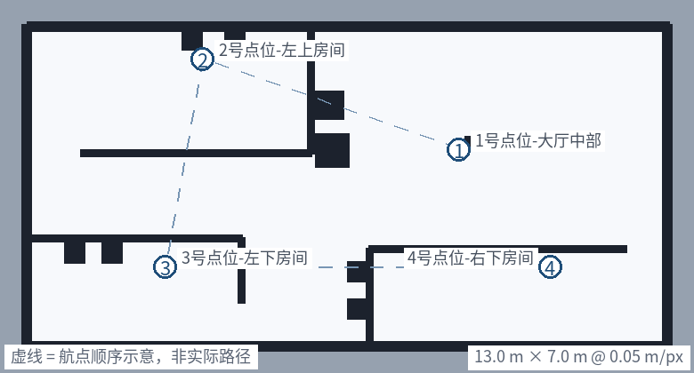

# patrol_ws · 差速小车自主建图 / 巡检 / 前沿探索

[](https://docs.ros.org/en/jazzy/)
[](https://docs.nav2.org/)
[](https://gazebosim.org/)
[](LICENSE)

**在 Gazebo 里跑一台两轮差速小车：SLAM 建图 → Nav2 导航 → 按航点自动巡检（到点拍照 + 中文语音播报 + CSV 记录），附带一个不依赖 `explore_lite` 的 frontier 自主探索节点，以及一个把 SDF 世界直接渲染成 Nav2 真值地图的小工具。**

A ROS 2 Jazzy + Gazebo (gz sim) + Nav2 demo: SLAM mapping, waypoint patrol with photo/voice/CSV logging, and a self-written frontier exploration node.



> 上图由 `docs/make_map_preview.py` 从 `maps/room.pgm` 与 `param/patrol_waypoints.yaml` 直接渲染；虚线只表示航点顺序，不是实际轨迹。

---

## 目录

- [功能](#功能)
- [环境](#环境)
- [构建](#构建)
- [快速开始](#快速开始)
- [四种用法](#四种用法)
- [参数速查](#参数速查)
- [话题与传感器](#话题与传感器)
- [实现要点](#实现要点)
- [踩坑记录](#踩坑记录)
- [与上游教程的关系](#与上游教程的关系)
- [TODO](#todo)
- [License](#license)

## 功能

| 功能 | 说明 |
|---|---|
| **一键巡检** | `patrol_sim.launch.py` 一次拉起 Gazebo + Nav2 + 巡检脚本，无需手工起节点 |
| **航点驱动** | 巡检路线写在 `param/patrol_waypoints.yaml`，改路线不改代码 |
| **到点作业** | 停 3 s → 相机拍 PNG → `espeak-ng` 中文播报点位名 → 写 CSV（序号/时间/点位/结果/耗时/照片） |
| **建图 / 导航双模式** | `slam:=true` 建图 + 自主探索；`slam:=false` 加载地图 + AMCL 定位 |
| **frontier 自主探索** | 自写节点：找边界点 → 聚类 → 视线检查 → 朝簇心走，带紧急避障与目标黑名单 |
| **真值地图生成** | 从 `.sdf` 直接渲染 `pgm/yaml`，顺带检查各房间可达性；SLAM 漂移严重时的备用方案 |
| **循环与熔断** | 巡检可无限循环；连续 3 个点位被 Nav2 拒绝会自动中止，避免空转刷日志 |
| **一键清理** | `停全部.sh` 两步（SIGTERM → SIGKILL）清掉 Gazebo 与 Nav2 全家桶，含孤儿进程 |

## 环境

- Ubuntu 24.04 + **ROS 2 Jazzy**
- **Gazebo Sim**（随 Jazzy 安装的 Gazebo Harmonic，`gz sim`，不是 Gazebo Classic）
- Nav2 / SLAM Toolbox / `ros_gz_bridge` / `nav2_simple_commander`

```bash
sudo apt install ros-jazzy-navigation2 ros-jazzy-nav2-bringup \
                 ros-jazzy-slam-toolbox ros-jazzy-ros-gz \
                 ros-jazzy-nav2-simple-commander \
                 python3-numpy python3-pil espeak-ng
```

> `espeak-ng` 是系统命令（不是 ROS 包），用于点位语音播报；没装也不会崩，只是播报自动关掉。

## 构建

```bash
cd patrol_ws
colcon build --symlink-install
source install/setup.bash
```

## 快速开始

```bash
# 一键：仿真 + Nav2 + 巡检（默认循环跑 4 个点位）
ros2 launch fishbot_navigation2 patrol_sim.launch.py

# 只起仿真、不巡检
ros2 launch fishbot_navigation2 patrol_sim.launch.py patrol:=false
```

跑完在 `~/patrol_log/` 下拿到当次 CSV 与照片（`log_dir` 参数可改）。

仓库根目录还有两个包装脚本：

```bash
./启动仿真.sh fishbot_navigation2 patrol_sim.launch.py   # 会自动清理 snap 版 VS Code 的 GTK 变量
./停全部.sh                                              # 停掉仿真/Nav2/巡检所有进程
```

## 四种用法

### 1）建图 + 自主探索

```bash
# slam:=true（默认）起 slam_toolbox；auto_explore:=true（默认）自动探索
ros2 launch fishbot_description gazebo_sim.launch.py

# 想手动遥控建图，就关掉探索
ros2 launch fishbot_description gazebo_sim.launch.py auto_explore:=false
ros2 run teleop_twist_keyboard teleop_twist_keyboard

# 探索结束（节点会打印“探索完成”）后保存地图
ros2 run nav2_map_server map_saver_cli -f src/fishbot_navigation2/maps/room
```

### 2）用现成地图导航

```bash
ros2 launch fishbot_navigation2 navigation2.launch.py \
    map:=src/fishbot_navigation2/maps/room.yaml
```

### 3）巡检（Nav2 已在跑时单独启动）

```bash
ros2 run fishbot_navigation2 patrol_inspector
ros2 run fishbot_navigation2 patrol_inspector --ros-args -p loop:=false   # 只跑一圈
```

### 4）从世界文件生成真值地图

SLAM 建图会受里程计漂移影响，出现墙体错位/重影；而 `.sdf` 里每堵墙的坐标都是精确的。这个脚本按几何直接渲染占据栅格：

```bash
python3 src/fishbot_navigation2/scripts/make_map_from_world.py \
    src/fishbot_description/world/fishbot.sdf \
    src/fishbot_navigation2/maps/room
```

产出 `room.pgm` + `room.yaml`，并额外做两项检查：各房间采样点是否落在空闲区、从出生点 `(0,0)` 洪泛填充能否走到每个房间（门洞没被堵死）。当前仓库里的 `maps/room.*` 就是它生成的。

## 参数速查

### `param/patrol_waypoints.yaml`（改路线只动这里）

| 字段 | 默认 | 含义 |
|---|---|---|
| `frame_id` | `map` | 航点所在坐标系 |
| `loop` | `true` | 跑完一圈是否重来 |
| `pause_at_waypoint` | `3.0` | 每点停留秒数（拍照/播报用） |
| `voice` / `photo` | `true` / `true` | 是否语音播报 / 拍照 |
| `waypoints[]` | 4 个 | `{name, x, y, yaw}`，yaw 单位 rad |

> 1 号点位故意离出生点 `(0,0)` 有 1.5 m：太近时 Nav2 会判“原地没进展”（`Failed to make progress`），在目标旁边磨几十秒才承认到达。

### `patrol_inspector` 节点参数

| 参数 | 默认 | 含义 |
|---|---|---|
| `waypoints_file` | 包内 yaml | 航点文件 |
| `log_dir` | `~/patrol_log` | CSV 与照片输出目录 |
| `camera_topic` | `/camera/image_raw` | 拍照用的彩色图 |
| `voice_name` | `cmn` | espeak-ng 嗓音（中文） |
| `goal_timeout` | `120.0` | 单点最长耗时（秒） |
| `photo_timeout` | `5.0` | 等一帧新图的最长时间 |
| `nav2_timeout` | `180.0` | 等 Nav2 就绪的最长时间 |
| `arrive_tolerance` | `0.6` | 已在该半径内就不再让 Nav2 挪 |
| `loop` | `''` | 留空=用 yaml；`true/false` 强制覆盖 |

### `param/nav2_params.yaml` 关键项

| 项 | 值 |
|---|---|
| 控制器 / 规划器 | MPPI（`nav2_mppi_controller`）/ NavFn |
| 平滑器 | SimpleSmoother |
| 代价地图分辨率 | 0.05 m |
| `robot_radius` | 0.12 m |
| `inflation_radius` | 0.22 m |
| 定位 | AMCL + `map → odom` |

### `auto_explore` 调参区（文件头部常量）

`CONTROL_HZ=10`、`FORWARD_SPEED=0.18 m/s`、`YAW_KP=1.8`、`FRONT_STOP=0.38 m`、`DANGER_STOP=0.22 m`、`REPLAN_PERIOD=1.0 s`。

## 话题与传感器

| 传感器 | gz 话题 | ROS 话题 | 频率 / 范围 |
|---|---|---|---|
| 2D 激光雷达 | `scan` | `/scan` | 10 Hz，360 线，0.12–20 m |
| IMU | `imu` | `/imu` | 100 Hz |
| 深度相机 | `camera` | `/camera/depth` | 30 Hz，`32FC1` |
| RGB 相机 | `camera_rgb` | `/camera/image_raw` | 15 Hz |
| 内参 | `camera_info` | `/camera/camera_info` | — |

底盘：轮距 0.20 m、轮半径 0.032 m、车体圆柱 0.12 × r0.10。

## 实现要点

**`patrol_inspector.py`（≈500 行，继承 `BasicNavigator`）**
- 启动先等 Nav2：查 `bt_navigator` 生命周期状态 + AMCL 出定位，超时再说
- 每点流程：`navigateToPose` → 结果判定（SUCCEEDED / 超时 / 被拒）→ 停留 → 拍照 → 播报 → 写 CSV 并 flush
- 相机回调只留最新一帧（`_img_seq` 自增），避免拍照拿到旧画面
- Ctrl+C：取消当前目标 → 往 `/cmd_vel` 灌几帧零速度 → 关文件，保证小车停下
- 熔断：连续 3 个点位返回 `UNKNOWN` 直接抛错退出（实测空转能刷 600+ 圈日志）

**`auto_explore.py`（frontier 探索）**
- `find_frontiers`：扫描占据栅格，找“已知空闲格紧邻未知格”的边界点
- `cluster_frontiers`：相邻边界点聚簇，避免贴着墙一个个啃
- `pick_goal`：挑“离自己最近 + 两点连线不穿墙（视线检查）+ 不在黑名单”的簇，朝簇心走
- 执行：先转向对准（`ALIGN_TOL`），再直行；`/scan` 做反应式避障（前方 0.38 m 转向、0.22 m 后退）
- 到达/超时/卡住 → 拉黑换簇；无 frontier 可挑 → 宣布完成并打印存图命令
- 旧版“有障碍就转向更宽的一侧”的反应式逻辑会结构性回避门洞（房间窄、大厅宽），地图永远只有客厅 —— 这就是重写的原因

**`make_map_from_world.py`**
- 解析 `.sdf` 里的墙/障碍几何，按 `resolution` 光栅化成 `0/205/254` 三值图
- 附带可达性洪泛检查，避免“地图看起来正常但门洞被堵死”

## 踩坑记录

1. **snap 版 VS Code 终端里起 rviz2 / gz gui 直接崩**（`undefined symbol __libc_pthread_init`）：snap 注入的 GTK/GIO 路径与系统库冲突，`启动仿真.sh` 里先 `unset` 掉再 launch。
2. **`gz sim server` 忽略 SIGTERM**：渲染/EGL 收尾时会卡住，必须 SIGTERM 等 3 秒后补 `SIGKILL`，`停全部.sh` 分两步做。
3. **`ros2 launch` 会漏杀子进程**：实测有 `opennav_docking` 活下来，白占 CPU 还继续订阅 TF，下次启动就变成两套系统抢资源 —— 所以 `停全部.sh` 把 Nav2 全家桶逐一点名，最后按 `/opt/ros/jazzy/(lib|bin)/` 兜底。副作用是同时开着的其他 ROS 项目也会被杀，按需注释。
4. **`depth_camera` 的 `<topic>` 上发的是深度图**，不是彩色图；`camera_info` 在 gz 侧叫 `camera_info` 而不是 `camera/camera_info`。彩色图另开一个 `camera` 传感器发在 `camera_rgb`。
5. **`ros_gz_bridge` 一条规则里 ROS 名与 gz 名是同一个字符串**，想改成 `/camera/image_raw` 只能用 `remappings`。
6. **巡检点位离出生点太近** → Nav2 反复报 `Failed to make progress`。
7. **两套仿真同时跑**会出现话题互抢、地图重影 —— `启动仿真.sh` 检测到已有 `gz sim` 会直接拒绝启动。
8. **SLAM 漂移导致墙体错位** → 用 `make_map_from_world.py` 渲染真值地图兜底（评估定位/规划算法时更干净）。

## 与上游教程的关系

本仓库基于《ROS 2 机器人开发：从入门到实践》/ fishbot 教程（Apache-2.0）的示例扩展而来：

- **沿用上游**：`fishbot_description` 的 URDF/xacro、`world/fishbot.sdf`、基础 launch、`mapper_params_online_async.yaml`
- **本仓库新增**：`patrol_inspector` 巡检节点、`auto_explore` frontier 探索节点、`make_map_from_world` 建图工具、`patrol_sim.launch.py` 一键巡检、`patrol_waypoints.yaml` 与巡检参数、`nav2_params.yaml` 的调参、`启动仿真.sh` / `停全部.sh`、`docs/make_map_preview.py`

如果你在别处复用上游代码，请保留其 LICENSE 与出处说明。

## TODO

- [ ] 巡检照片接目标检测（YOLO）自动上报异常
- [ ] 用 Nav2 `route_server` 做环形路线，替代逐点 `navigateToPose`
- [ ] `patrol_inspector` / `auto_explore` 补 pytest 单测（纯函数已可测：`find_frontiers`、`pick_goal`、`yaw_to_quaternion`）
- [ ] 加一段 Gazebo 运行 GIF 与 RViz 截图
- [ ] 多楼层 / 多机巡检

## License

[Apache-2.0](LICENSE)（沿用上游许可）。
